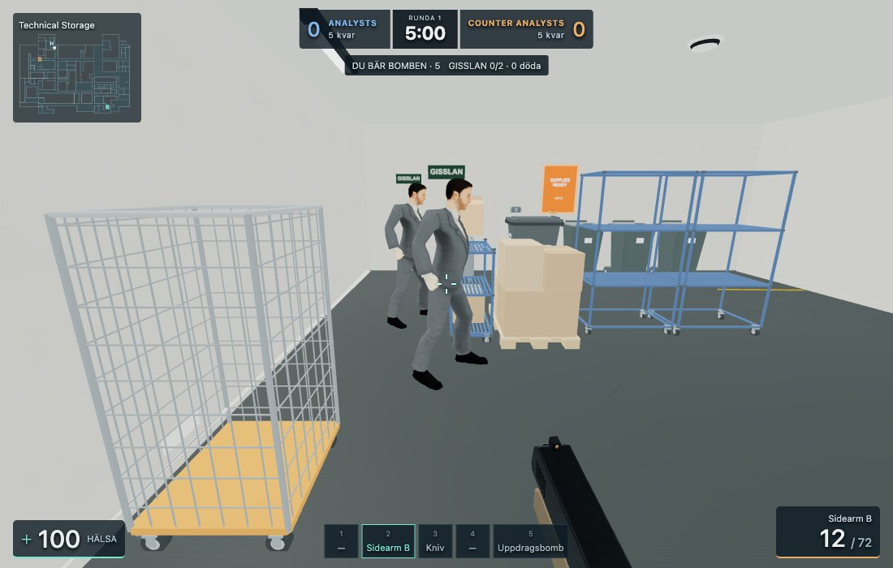
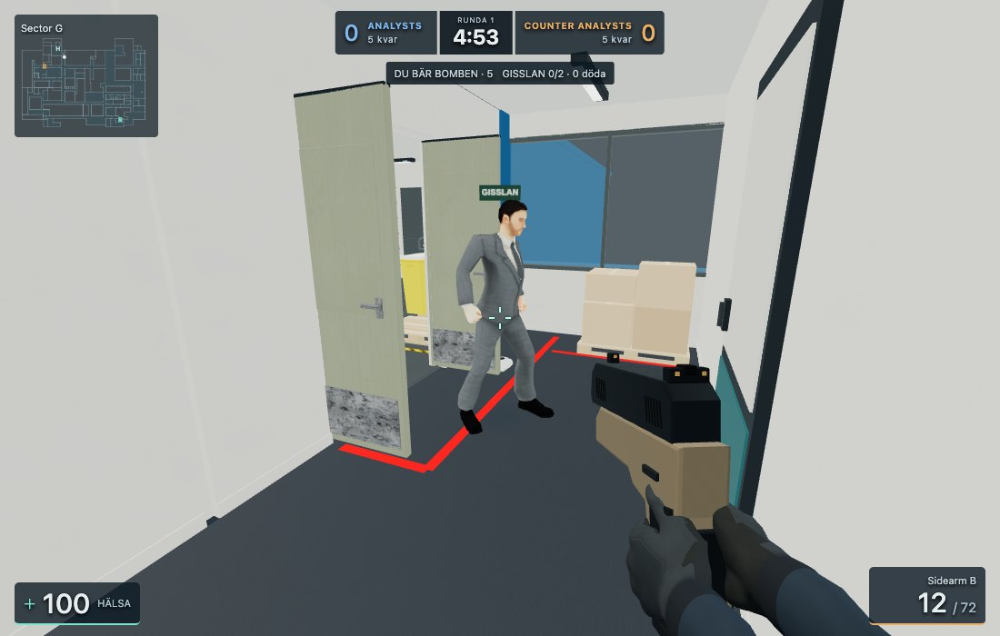
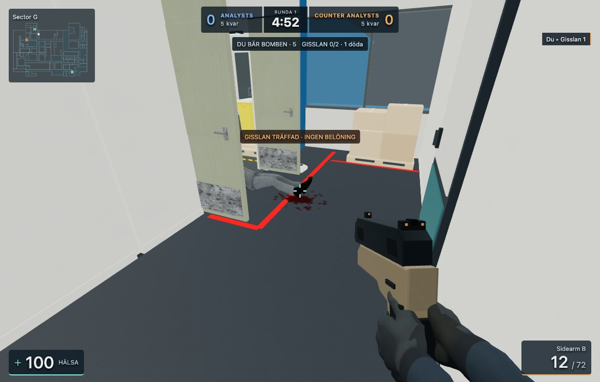
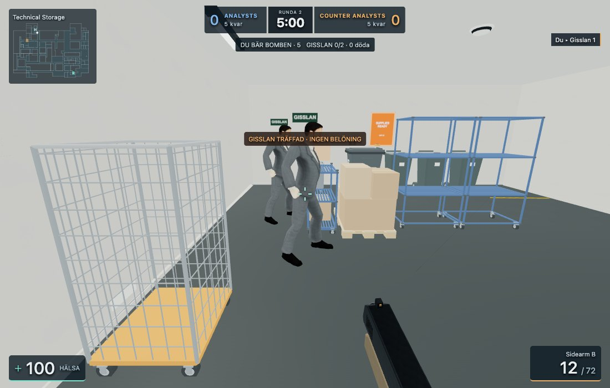

# Business Man hostage default

Both shipped hostage roles use the existing root `Business_Man_Quaternius_Anims.glb`.
The file itself is unchanged: 10,179,392 bytes, 71 native bones, three skinned meshes,
4,574 triangles and thirteen clips. Its native +Z front is adapted by the existing
avatar holder's half-turn; Y remains up. The established 1.69 m visual normalization
is retained. Hostage gameplay height remains 1.6 m and radius remains 0.20 m.

FPS preloads one template before enabling Start. Geometry, the original material,
textures, native clips and cached foot-support indices are shared; each actor owns
its skeleton and mixer. No GLB copy, new lights or shadows were added. The lowest
of 243 cached foot-weighted vertices keeps alive poses 4 mm above the floor, without
changing actor coordinates, navigation or collision. The existing Death01 corpse
alignment and aisle fitting are retained; this is animated presentation, not ragdoll
physics.

Character Studio exports retain their existing operator source/rig contract.
Individual hostage assignments and `hostage-all` take priority over the default;
removing an assignment restores Business Man. Player appearances are unchanged.

Validation:

- 83 character/export/footwear/first-person appearance tests passed, including the
  actual GLB's thirteen clips, independent skeletons and shared resources, sampled
  floor contact, actor immutability, and Studio export/reimport/override priority.
- `tools/character-hostage-browser.mjs` ran the actual local FPS in Chromium with
  software WebGL: native shipped hostage spawns, idle, E interaction, physics/path
  escort, Walk/Jog/Idle transitions, Death01, then the next round at original spawns.
  Only the observing player was positioned for the controlled test/captures.
- The GLB was requested once for both hostages; no page/console errors. See the
  measured [report](business-hostages/report.json) and final FPS captures below.

This is a short controlled desktop software-WebGL check, not a long multiplayer
session or a physical mobile/Safari certification.
