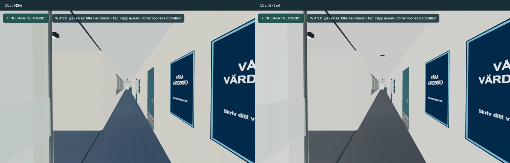
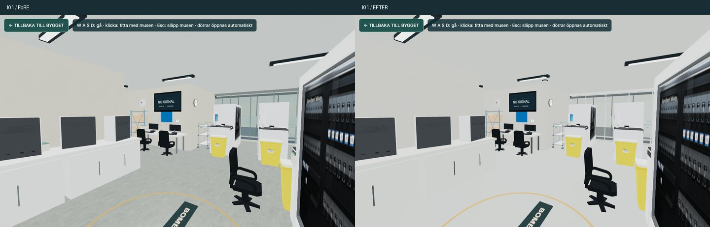
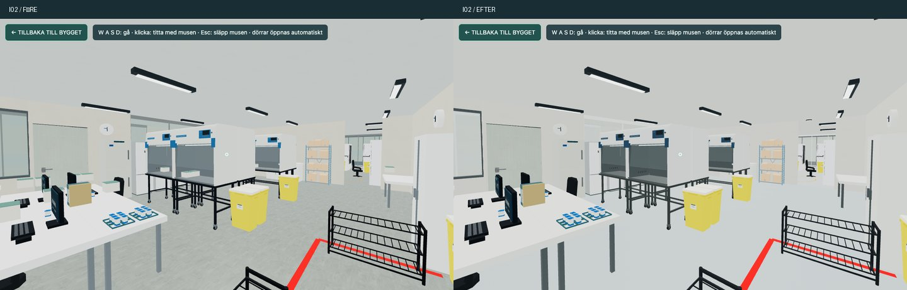
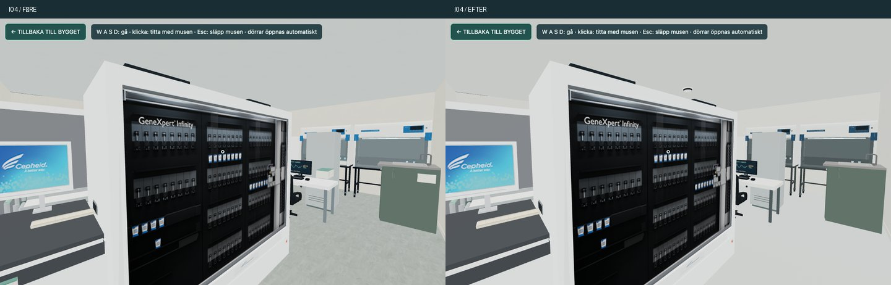
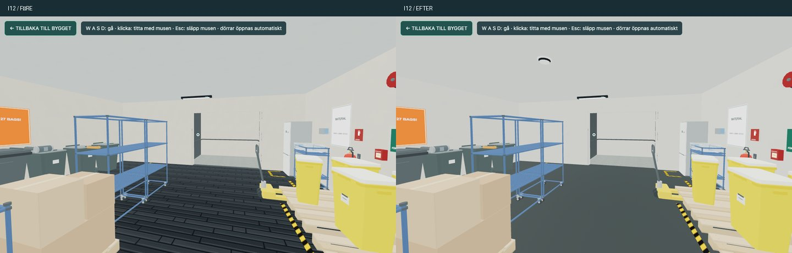
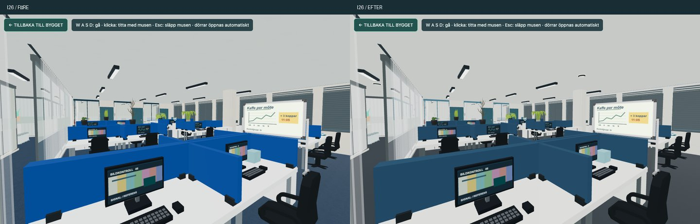
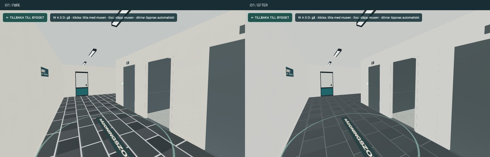

# Floor 5 – genomfört material- och dekorpass

2026-11-06. Utgår från senaste `main`, `e9eeb141a746a2c653ff1cb20c53d26c3374787e`, och [Works visuella riktning](floor5-visual-direction.md).

## Ändrat

- Hela den felaktiga `cartridgeBoxes`-loopen i `src/fps/decor.mjs` är borttagen. Före skapades 95 grå/gröna dekorationslådor över labbhinder i I01/I02/I04; efter skapas noll. Varken projektföremål, riktiga Cartridge-modeller eller hyllkartonger filtreras bort.
- 79 enkla vita, runda rökdetektorer under befintliga tak i labb, kontor/mötesytor och korridorer. Deterministisk placering söker takstöd och fri yta, håller undan från armaturer/höga hinder och undviker närliggande detektorer, inklusive identifierbara användarplacerade detektorer. Tre återanvända lågpolygonformer sammanfogas per rum/material och använder befintlig rumscullning. Ingen kollision, larmfunktion eller ny ljuskälla. Befintliga klockor, larmknappar och släckare är orörda.
- Slät neutral/kall labbvinyl i I01/I02/I04; mörk industrivinyl i I12/I13 i stället för blanka plankor; lugnare stenfog i I21/I31/I33. Avgränsat till det förberedda projektet och dess befintliga golvtyper. Användarens ytfärg har fortsatt företräde, och ett senare byte av golvtyp respekteras. Delad finishkod används i Designstudion och FPS utan nytt projektformat.
- Tät mörk kontorsmatta, varmvita väggar, lugnare tak, dämpad blå möbeltextil, sidenmatt laminat, mörka instrumentfält och renare plast. Målad metall har M 0; bart stål behåller metallkaraktären och får fin borstning i roughness. Hissbladen får blå lack. Glas och egen signalgrafik har lugnare ton utan ändrade glasytor eller brottstillstånd.
- Små delade lokalt genererade kartor ger mycket svag kornighet, glanspolering och stålborstning. Inga repdekaler eller extra golvföremål. Befintliga sulskrap dämpas. Importerade GLB-original är oförändrade.

`levels/`, möbeltransformationer, projektdata, väggar, dörr-/hissmekanik, kollisions- och navigeringskod är oförändrade. Materialpasset lägger inga trianglar på befintliga ytor; de efterfrågade takdetektorerna tillför 11 376 trianglar totalt före cullning. Scenen har fortfarande tre befintliga ljus, utan aktiverade dynamiska skuggor i den förberedda banan.

## Kontroll

- 68 relevanta FPS-/projekt-/finish-/miljötester, 17 möbeltester och 87 befintliga runtime-regressioner passerade.
- `node tools/verify-owner-runtime.mjs`: 631 runtimefiler, version 0.18.0; uppdaterade publiceringshashar.
- `node tools/floor5-appearance-smoke.mjs`: faktisk Chromium/WebGL, standard/låg grafik, identisk I12-finish i studion och FPS, öppna/stängda hiss- och glasdörrar, glaskross/återställning och kort rörelse med spelarkapseln. 1 020 projektföremål, noll genererade labblådor, 79 detektorer, tre ljus, inga rapporterade sid-/konsolfel.
- Visuell genomgång av I01, I02, I04, I12, I26, C02 och I31 från gångbara kameror. Felaktiga dekorationslådor är borta; befintliga maskiner, Cartridge-föremål, hyllkartonger och gångytor är kvar.
- `git diff --check` passerade. Projektfil och ägande geometri-/kollisionskällor är byteidentiska med basen.

Detta är ett avgränsat lokalt prov med arrangerade kameror och mjukvaru-WebGL, inte ett manuellt matchtest eller en mätning av hårdvaru-FPS. Ingen fysisk mobil/Safari-kontroll har gjorts. Bildernas räknare visar direkta scenrenderingar, inte full kostnad för en spelbild. I dessa sju vyer ändrades draw calls från 429/1339/131/218/462/1753/505 till 431/1371/133/223/465/1765/499; detaljer finns i [kameror och räknare](floor5-material-pass/captures.json). Alla delar av den längre visuella planen, exempelvis modellbundna originaletiketter och mer omfattande LOD-arbete, ingår inte i detta materialpass.

## Samma kameror före / efter

1100 × 660, samma exponering, ljus och standardkvalitet. Verktyg: `node tools/floor5-material-captures.mjs after`. Förebilderna använder basens runtimefiler via en separat lokal server; kamerorna är identiska inom varje par.

