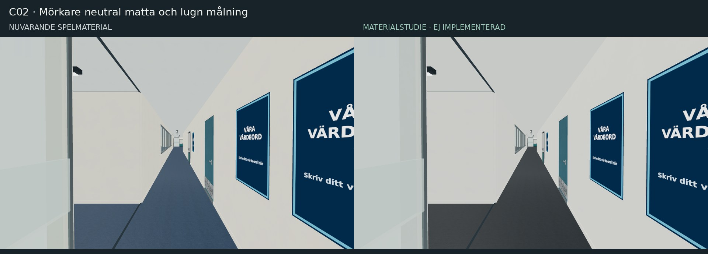
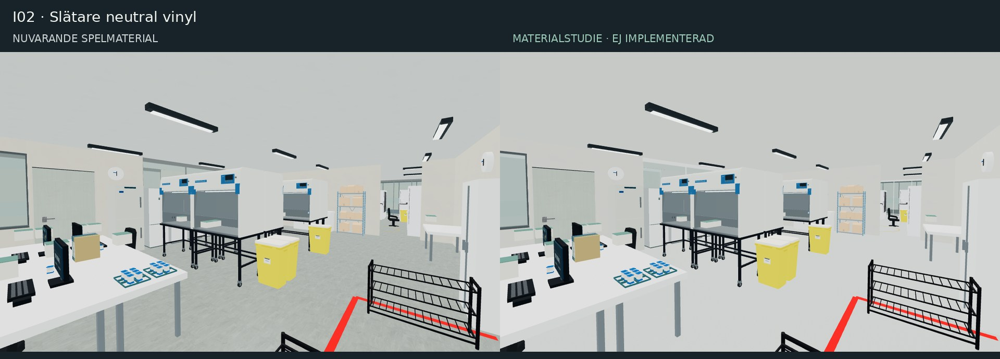
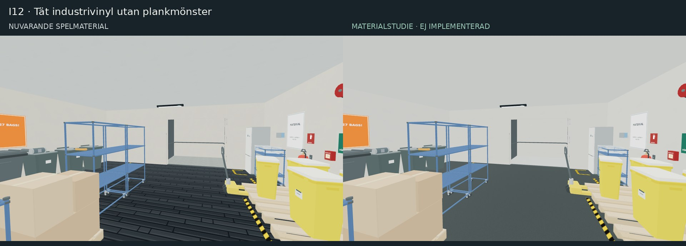

# Floor 5 – visuell riktning

Datum: 2026-11-06. **Detta är en genomförandeplan för utseendet. Den här leveransen ändrar ingen spelkod, bana eller spelregel.**

## Målet

En välskött, använd och trovärdig arbetsmiljö: målade väggar, mjuka textilgolv, slät labbvinyl, lackerad och borstad metall. Materialen ska skilja sig genom glans och fin ytstruktur även när färgerna liknar varandra. Liv kommer främst från materialvariation och befintlig inredning, inte från fler saker på golvet.

Bevara nuvarande väggar, fönster, dörröppningar, takhöjder, rumsgränser, möbelplaceringar, kollisioner, navigering, skott/siktregler, starter och mål. Fotona och Jedi är utseendereferenser; deras perspektiv och modeller får inte användas för att räkna fram nya mått eller bygga om Floor 5. Alla storlekar nedan är föreslagna texturskalor i spelets provisoriska modellenheter, inte kontrollmätta verkliga mått.

## Granskat underlag och vad som är säkert

| Underlag | Granskad version | Användning |
| --- | --- | --- |
| `capstere/onboard/references/photos/floor5-previews/P01.jpg`–`P33.jpg` | onboard `55d8dacb6df7b3373ca771d8de22982a1e900d36` | Samtliga 33 bilder visuellt granskade. Endast material, färgfamiljer och stämning överförs. Bilderna kopieras inte till detta repo. |
| `onboard/reviews/floor5-photos/mapping.json` | blob `70b92252d3dab881324de8e747737428515f9fd4` | Befintlig rumskoppling och osäkerhet behålls. 6 confirmed, 22 estimated, 5 unknown. Även confirmed har uppskattad kameraposition/riktning. |
| `capstere/jedi/Hissrum12_V5_med_39_objekt.glb` och Layout Studio V5 | jedi `45fa87611abbb21330febd157a25ec8128576c9e` | GLB:s material och struktur granskade, tillsammans med V5:s översikts- och godshissbilder samt studions källkod. GLB är cirka 6,48 MB med 80 material; det är en referens, inte ett paket att importera i sin helhet. |
| Aktuell Cartridge-Strike | `f0bad6110ee4d96f96090fb93af7573bf89a6a24` | Standardbanan är `floor5-prepared` via `levels/manifest.json`, inte den historiska Classic-banan. Projektet är `lvl-floor5-preppad-20261105`. |

Färgerna i planen är **konstnärligt valda sRGB-värden**, inte exakta färgmätningar från fotografier. Kamerornas vitbalans och ljuset varierar. Bilder med liknande motiv är inte oberoende bevis på en placering.

### Bild för bild: observation → användbar spelanvisning

Rumskoderna är befintliga tekniska ankare. En uppskattad kod blir inte bekräftad av att stå i denna tabell.

| Foto | Fotokartans status / kandidat | Visuellt iakttaget och överföring till spelet |
| --- | --- | --- |
| P01 | Confirmed, I10 | Mörkblå fondvägg, runt ljust bord, blå/gröna stolar, mörkt svagt blankt golv. Behåll lugn blå fond och tydlig skillnad mellan bord och golv. |
| P02 | Estimated, I10; **D42-konflikt** | Samma blå pentryfamilj, vita skåp, mörka apparater och frostat glas. Överför material; koppla inte om någon dörr. |
| P03 | Confirmed, C16 mot D08 | Mörk textilmatta, varmvit slät vägg, grå karmar, frostad glasremsa, runda takljus. Grundrecept för korridor. |
| P04 | Confirmed, C02 vid D21 | Lång glasad sida med ljusa gardiner, vit motsida och mörk matta. Använd rytm och låg kontrast i glaset; ersätt vägggrafik med egna abstrakta motiv. |
| P05 | Estimated, C15 | Smal passage, grå dörr, glas på ena sidan, mörkt golv. Minska materialbrus och upprepade dekaler. |
| P06 | Unknown | Bredare kontorspassage, grå glasramar, vita skåp, mörk matta. Materialreferens utan rumsplacering. |
| P07 | Unknown | Glasade dörrar, varma trösklar, mörka stolar och mobil tavla. Behåll kontrast mellan mjukt golv och hårda karmar, inte tavlans innehåll. |
| P08 | Unknown; I07 eller I15 möjliga | Små grå golvplattor, vita dörrar, mörk sockel. Använd för befintliga WC-ytor utan att välja en ny rumsidentitet. |
| P09 | Estimated, C08 | Glasat hörn, växter, paneltak, tillfälligt byggmaterial. Överför glas/matta/växtfärg; utelämna byggmaterialet. |
| P10 | Estimated, C08 | Ljust öppet kontor bakom glas, gardiner och skyddat golv under arbete. Skyddspapp och byggskede blir inte permanenta texturer. |
| P11 | Estimated, C08 | Motvy med blå bordsskärmar och mörkt gångstråk. Återanvänd samma färgfamilj; kopiera inte kartonger och högar. |
| P12 | Estimated, C10 | Lång skåpsrad, grå dörrar, frostat glas, mörk matta och ljusa trösklar. Släta lackerade skåp med små skillnader i glans. |
| P13 | Estimated, C11 | Glas på båda sidor, vita gardiner och upprepad frostning. Behåll tydlig glasrytm, ersätt alla logomotiv. |
| P14 | Unknown | Glas, tavlor och röda släckare. Små säkerhetsaccenter i egen grafik, inte en kopierad dokumentvägg. |
| P15 | Estimated, C10 | Grå dörrar, mörk matta och många anslag. Bevara dörrarnas läsbarhet; reducera anslag till ett fåtal fiktiva färgfält. |
| P16 | Estimated, C08 | Vita skåp, avfallsgrupp och glasad passage. Vita ytor ska vara målade/laminerade, inte metalliskt blanka. |
| P17 | Estimated, C11/I26 | Öppet kontorsstråk med glas, släckare och långa siktlinjer. Håll ögonhöjd lugn och fri från extra dekaler. |
| P18 | Estimated, C11/I19 | Kaffehörna, grå dörr och tillfällig golvmarkering. Ta mörk apparatplast och ljus bänk; återskapa inte tillfälliga markeringar. |
| P19 | Unknown | Grå dörr i smal vit passage, mörk sockel och golvskydd. Endast dörr-/väggmaterial; ingen ny passerkortsdörr eller öppning. |
| P20 | Estimated, C14 | Smal vit passage, mörka dörrar och delvis öppet installationstak. Bevara nuvarande tak; fotot motiverar inte att ta bort det. |
| P21 | Confirmed, I26 | Ljusa skrivbord, blå tygskärmar, svarta stolar, växter och mörk matta. Kontorets huvudpalett. |
| P22 | Confirmed, I26 | Närliggande vy av samma skrivbordsgrupp. Fin textilstruktur, vit laminat, varm neutral belysning; inga skärm- eller papperskopior. |
| P23 | Estimated, I02 | Ljus slät labbvinyl, vita bänkar, blå väggförvaring och rostfritt. Små gula säkerhetsaccenter, inte smutspatina. |
| P24 | Estimated, I02 | Vita arbetsytor, glasfrontad kylförvaring och metallvagn. Skilj glas, lack och metall genom glans. |
| P25 | Estimated, I02 | Stor ljus huv med glasfront och metallskåp med kallare insida. Behåll stora rena former; dämpad skärmton utan extra ljuskälla. |
| P26 | Estimated, I02 | Dator-/vågbänkar och svarta labbstolar. Vit laminat med svag glans, mjukt matt svart sits. |
| P27 | Estimated, I02 | Röda instrumenttoppar, glasad förvaring, vita bänkar. Enstaka mörkröda accenter på fiktiva instrument; inga originaletiketter. |
| P28 | Estimated, I01 | Stora ljusa maskinkroppar med mörka glasfronter. Prioritera skillnaden mellan lack och mörk front, inte fler maskindelar. |
| P29 | Estimated, I01 | Flera maskinfronter, skärmar och gula kärl. Behåll stora materialfält och dämpad indikering. |
| P30 | Estimated, I01 | Mörka maskinbaksidor med galler, smal passage och svart pall. Galler som textur/normal på befintlig yta, inte nya lameller. |
| P31 | Estimated, I01 | Vit instrumentbänk, svarta skärmar, rostfri våtdel och röd vagn. Metall behöver en annan reflex än vit lack. |
| P32 | Estimated, I01 | Närmare våtdel, blå hållare, gul behållare och blå platsmarkering. Använd få tydliga färgaccenter; inga kopierade instruktioner. |
| P33 | Confirmed, I26 | Samma kontorsmotiv som P21/P22 med blå tygskärmar, mörkt golv, växter och ljusa gardiner. Bekräftar materialfamiljen, inte tre olika rum. |

**Osäkerheter som ska finnas kvar:** P02:s filalias D42 pekar på ett annat rum i ritningen; D54 är bara en kandidat. P05, P09–P13, P15–P18 och P20 har uppskattade områden. P06/P07/P08/P14/P19 saknar vald säker punkt. P23–P27 ↔ I02 och P28–P32 ↔ I01 är visuellt sammanhängande grupper men inte verifierade rumsregistreringar. I04 har inget bekräftat foto. Alla fotoankare, meterskala och kamerariktningar förblir omätta. Hisshallarna och Hissrum 12 saknar säker fotoförankring i de 33 bilderna; Jedi ger referenskaraktär för I12, inte mått eller placering i Floor 5.

## Gemensam materialpalett

R = roughness: 0 är mycket blankt, 1 mycket matt. M = metalness: använd 0 för färg, plast, tyg och vinyl även när underlaget är metall. Metallvärdena gäller synlig, olackerad metall. Parametrarna är startvärden som måste bedömas i den aktuella spelvyn.

| Yta | Färg | R / M | Struktur och gräns |
| --- | --- | --- | --- |
| Målad varmvit vägg | `#E8E7E1` | .84 / 0 | Mycket fin rollerstruktur. Normalstyrka .04–.08 på nuvarande skala; ingen grov betong eller stora putsfläckar. |
| Kallare labbvit | `#E5E9E6` | .76 / 0 | Jämn tvättbar målning. Högst ±2 % ljusvariation mellan stora sammanhängande ytor. |
| Akustiktak | `#E1E3DF` | .96 / 0 | Fin porighet, svagt rutnät i textur på befintligt tak. Inga extra takplattor som geometri. |
| Sockel / gummi | `#454B4B` | .88 / 0 | Dämpad sammanhängande kant; ingen svart smutsrand runt hela rummet. |
| Kontors-/korridormatta | `#42494F` | .98 / 0 | Tät småskalig väv, normal .12–.18. Subtil riktningsskillnad, inga stora säckvävsöglor. |
| Blå bordsskärm / mötestextil | `#35556D` | .98 / 0 | Mjuk textil utan högdagrar. Normal .10–.16. |
| Labbvinyl, neutral | `#C5CBC7` | .62 / 0 | Fin nästan osynlig spräcklighet; normal .02–.05. Ingen betongkrackelering, träådring eller djup fog. |
| Labbvinyl, kall variant | `#BDC9CB` | .65 / 0 | För I02; mycket liten skillnad mot neutral, inte färgkodad blå hall. |
| Hiss-/servicegolv | `#4D5555` | .58 / 0 | Tät slät industrivinyl med små tonkorn. Inga långa blanka träplankor. |
| Mörk lobbyplatta | `#444B4E` | .70 / 0 | Stor lugn stenplatta; fog `#747C7D`, smal och lågkontrast. |
| Vit laminat / skåp | `#E7E9E4` | .48 / 0 | Nästan slät, svagt sidenmatt. Ingen grov puts på möbler. |
| Grå dörrlack / karm | `#858E90` / `#6D777A` | .56–.65 / 0 | Svag apelsinskalsstruktur på dörr, slätare karm. |
| Blå hisslack | `#52788A` | .53 / 0 | Stor lugn färgyta, liten blankare zon vid handtag. |
| Borstad stål/aluminium | `#A6AFB0` | .34–.46 / .78–.90 | Fin ensriktad borstning i roughness/normal; inte vita repor i färgkartan. |
| Svart plast / stol | `#272E32` | .70–.86 / 0 | Undvik absolut svart. Lätt kornighet, ren silhuett. |
| Klart glas | `#CCD8D8` | .15–.22 / 0 | Mycket svag ton, startopacity .10–.16 på befintliga glasytor. Ingen extra glasruta ovanpå. |
| Frostad remsa | `#D5DDDA` | .78 / 0 | Startopacity .45–.55; behåll befintlig remsas utbredning tills siktregler verifierats. Egen neutral grafik. |
| Ljus gardin | `#E8E9E2` | .98 / 0 | Fin väv och mjuk veckskugga. Behåll användarens befintliga täta/tunna val. |
| Kartong / ljust trä | `#AE8D65` / `#B6A080` | .90 / 0 | Få stora veck/ådror, helt fiktiva omärkta lådor. |
| Begränsade accenter | blå `#35556D`, gul `#D3B34F`, röd `#A8443F`, grön `#66856E` | .65–.85 / 0 | På befintliga föremål och små grafikfält; inte på hela rummet. Lunchstolar får behålla orange `#BC713E`. |

Använd högst tre fasta tonvarianter per materialfamilj. Fördela dem deterministiskt efter befintligt yt-ID, aldrig slumpvis varje bildruta. Samma väggstycke får inte byta nyans mellan olika renderingsbatcher.

## Rumsvisa anvisningar

### Korridorer – särskilt C02, C16 och kontorsstråken

**Prioritet P0.** Referenser P03–P07 och P09–P17. De namngivna säkra ankaren är C02/C16; övriga bilder anger materialfamilj.

- Vägg `#E8E7E1`, tak `#E1E3DF`, tät matta `#42494F`, grå lackerade dörrar och karmar. Befintliga blå dörrval byts inte globalt; välj uttryckligen kontorsdörrar per ID, behåll hissarnas blå identitet.
- Låt glaset vara läsbart via karm, svag reflex och neutral frostning. Ta bort upprepade företagsliknande blå motiv; ersätt med enkel egen streckgrafik i `#7C959D` eller en helt neutral remsa. Ingen glasvägg flyttas eller görs till öppning.
- Diskret patina: små avbrutna skrap vid sockeln på någon enstaka befintlig transportpassage, cirka .15–.35 modellenheter långa. Maximal lokal färgskillnad 3–5 %. Matta får bred mycket svag slitagevariation, inte en ljus upptrampad motorväg.
- Atmosfär: tydligt ljust tak, lugna väggar och mörkt mjukt golv. Behåll befintliga lampor; neutral till svagt varm armaturyta `#F2EEE1`, utan bloom eller nytt punktljus per armatur.
- Förenkla: återkommande affischgrupper till en fiktiv huvudskylt och högst två mindre färgfält per befintlig tavla. Inga långa rader med läsbar dokumentation. Behåll vägvisning och objektivmarkörer tydligare än dekoren.

### Öppet kontor I26, mötesrum I14/I16/I17/I22–I24 och lounge I25

**Prioritet P0 för I26, P1 för övriga.** P21/P22/P33 ger starkast kontorsstöd. Övriga rum använder en medvetet besläktad fiktiv palett, inte påstådd fotomatchning.

- I26: matta `#42494F`, bord/skåp `#E7E9E4`, blå textil `#35556D`, stolar `#272E32`, bordsben borstad metall. Skrivbord ska läsa som laminat, inte trä eller målad vägg.
- Mötesrum: samma material, högst en mild accent `#66856E` eller dämpad blå. Behåll befintliga blå stolar och deras placering. I25 får varmare textil `#8B8171` i befintliga sittmöbler, inte ett nytt möblemang.
- Gardiner: följ befintliga behandlingar och vald sida av glaset. Skapa ingen ny heltäckande gardin som skymmer en tidigare öppen siktlinje. Mönster ska vara egen enkel väv, inte foto eller identifierbart originaltryck.
- Patina: svag roughnessvariation på bordets befintliga framkant; inga kaffefläckar över hela arbetsytan. En aning blankare stolarmstöd, inte bortskavd svart färg på alla kanter.
- Liv: behåll ett fåtal befintliga växter och personliga småföremål. Skärmar visar egna enkla fönster/färgblock utan verkliga dokument, namn eller systembilder. Förenkla små tangentbord, pappershögar och persiennlameller på avstånd genom LOD eller textur, med bevarad större silhuett.

### Laboratorium I01 – instrumentrummet

**Prioritet P0.** P28–P32 är en sammanhängande visuell referens, men kopplingen till I01 är estimated.

- Golv neutral vinyl `#C5CBC7`, vägg `#E5E9E6`, tak `#E1E3DF`. Golvet får mjuk bred glans, ingen blank sten eller synlig betongstruktur.
- Befintliga stora instrument: vit lack `#DEE3DF`, mörka fronter `#263238`, stål `#A6AFB0`. Fronterna ska vara mörka glas-/plastfält med glans .28–.38, inte ljusblå ogenomskinliga rutor. Ingen nytillverkad exakt maskinkopia krävs.
- Gör fläktgaller, paneldelningar och några indikatorer i en gemensam egen texturatlas på befintliga ytor. Indikatorfärg `#73A69A` får vara svagt emissiv utan att kasta ljus. Inga blinkningar på varje maskin.
- Patina: borstning på våtdel, någon svag hjulpolering i golvets roughness och små slitagezoner på handtag. Inga rostkanter, spill, biologiska spår eller smutsiga arbetsbänkar.
- Förenkla dubbla små etiketter, individuella ventilationsribbor och flaskor som bara skapar brus. Alla modellbundna varumärken, logotyper, serienummer och verkliga instruktioner ersätts i godkända derivat med neutrala paneler. Ingen originaletikett återpubliceras som textur.

### Laboratorium I02 – bänkar och säkerhetskabinett

**Prioritet P0.** P23–P27 ↔ I02 är estimated; apparaternas exakta positioner från fotot ska inte överföras.

- Golv `#BDC9CB`, vägg `#E5E9E6`, vita bänkar `#E7E9E4`, matta svarta stolar och borstad metall. Befintliga blå tillbehör `#35556D`, små röda instrumenttoppar `#8E4943`, enstaka gula kärl `#D3B34F`.
- Bänkskiva R .48 och skåpsida R .60 ger bättre separation än en kraftig färgskillnad. Kyl-/kabinettglas använder samma glasfamilj som resten av banan med mörkare bakgrund, utan extra reflektionskamera.
- Patina begränsas till vagnhjul, bänkarnas yttre kanter och handtag. Själva arbetsytan och kabinettets arbetszon förblir rena. Ingen allmän sotig kontaktrand under varje skåp.
- Samla gula/svarta säkerhetsränder till befintliga relevanta platsmarkeringar. Öka inte antalet. Behåll stöd, skoställ, befintliga maskiner och gångbredd.
- Granska små plastlådor med ID `NY-OBJ-0414`–`0417` och `NY-OBJ-0421` som kandidater för minskad visuell upprepning. Dessa har explicit `collision: none` i projektet. Ta bara bort en renderad dekor om den är överflödig efter bildkontroll; lådor med saknat kollisionsfält antas inte vara dekor. Större hinder får aldrig bli osynliga.

### I04 och övriga befintliga laboratorie-/serviceytor

**Prioritet P1.** I04 har inget bekräftat foto. Använd labbfamiljen med neutral vinyl `#C5CBC7`, vägg `#E5E9E6` och befintlig inredning. Inga nya rumsfunktioner, väggöppningar eller påhittade apparatrader härleds ur P23–P32. För andra öppnade labbytor, exempelvis miljölagrets X21, kontrollera faktisk rumsfunktion i aktuellt projekt före materialtilldelning; förvandla inte alla X-ytor till samma labb. Blockerade ytor förblir blockerade.

### Hisshallar I31/I32/I33 och Hissrum 13/I13

**Prioritet P0 för dörrmaterial, P1 för ytvariation.** Detta är spelanpassad riktning, inte en fotobekräftad rekonstruktion.

- I31/I33: behåll nuvarande stora mörka lobbyplattor och deras utbredning, men tona ned den ljusa fogen till `#747C7D` och håll R omkring .70. I32 behåller sin befintliga golvutbredning och får samma familj där den faktiskt finns.
- I13: låt befintlig golvyta läsa som mörk tät industrivinyl `#4D5555`, R .58, i stället för spegelblankt planklaminat. Ändringen gäller ytskiktet, inte golvpolygon eller höjd.
- Blå hisslack `#52788A` med M 0, borstad karm/tryckplatta `#A6AFB0` med M .85, varmvit vägg. Små fiktiva våningssiffror och egna pilar kan ersätta originalinstruktioner på befintliga skyltfält.
- Låt trösklar och handtag vara lite blankare än dörrbladen. Högst ett fåtal svaga korta vagnskrap på dörrens nedre del. Behåll befintlig dörranimation och öppningsriktning.
- Ingen dramatiskt mörk hisshall, ny spotlight, dimma eller stark ljusrand som döljer aktörer. Rummets karaktär kommer från blått lack mot stål och grått golv.

### Hissrum 12 / I12

**Prioritet P0 för golv/metall, P1 för patina.** Jedi ger den tydligaste separata referensen: mörk golvyta, ljusa väggar, blå kraftig hiss, blå rörvagnar, ordnade gula kärl och brun kartong. Modellens tak, balk, hisskabin och inredningsantal överförs inte till Floor 5.

- Byt utseendet på nuvarande `dark-gloss-laminate` till tät mörk industrivinyl `#4D5555`, R .58, M 0. Ta bort plankornas ådring och långa blanka skarvar. Återanvänd befintligt golvmesh och polygon.
- Vägg `#E8E7E1`, tak `#E1E3DF`, blå hisslack `#52788A`. Befintliga blå rörvagnar får `#294A66`, R .60, M 0; synliga axlar/handtag kan vara stål. Befintliga gula kärl `#D3B34F` och kartong `#AE8D65` ger begränsade varma accenter.
- Använd befintliga golvmarkeringar som ordningsstruktur. Sänk övermättad dekorativ tejp ett steg i färgstyrka; ändra inte uppdragszoner eller markeringarnas positioner. Skapa inte nya markeringar som ser ut som spelbara områden.
- Patina: några mjuka hjulbågar i roughness nära befintliga transportytor, svagt blankare tröskel och små repor på blå dörrs nederkant. Ingen grov rost, stora fläckar eller staplad extra rekvisita.
- Förenkla: färre transparenta lager på små förvaringslådor, galler som textur på avstånd, färre individuella kopplingsdetaljer i rörvagnarnas LOD. Behåll vagnarnas silhuett, hjulstöd och alla hinder som påverkar spelet.
- Importera inte hela 39-objekts-GLB:n, nya väggar, hissdörrar eller V5:s simulerade personer. Skapa inga kopior av befintlig kabin. Använd endast redan granskade biblioteksobjekt där de redan står.

### Pentry, lunch och mindre serviceutrymmen

**Prioritet P1.** I10 stöds av P01/P02. I09/I19 använder samma besläktade material utan påstådd exakt fotomatchning. Behåll lunchens orange stolar, vita bord och redan placerade apparater. I10:s befintliga fond kan få `#35556D`; golv mörk neutral vinyl `#555854`, R .55. Apparater är matt svart plast och borstad metall. Lägg inte till koppar, tallrikar eller fler smulor för att skapa liv.

I06/I07/I15: behåll befintliga små golvplattor och rumskonstruktion. P08 stödjer materialtypen men väljer inte rum. Ljusgrå platta `#777F7E`, fog `#666F6D`, vit målad dörr och mörk sockel är ett lugnt alternativ vid kommande materialpass. För I03/I29, förråd, print- och städytor: återanvänd neutral målad vägg, vinyl/platta enligt befintlig funktion och rena skåp; ingen dekorativ nedsmutsning eller obekräftad ombyggnad. I34/I35:s osäkra funktionshistorik löses inte med ny inredning.

## Diskret patina: gemensamma regler

1. **Ändra främst glans.** Små roughnessförändringar på berörda ytor, inte ljusa repstreck överallt. Exempel: lack R .56 → .48 vid handtag, industrigolv .58 → .52 i någon hjulbåge.
2. **Välj få platser.** Högst två till tre tydliga bruksspår per typisk rumsvy och stora rena mellanrum. Slitage följer befintliga handtag, stöd och transportvägar; inget slumpbrus över hela byggnaden.
3. **Separera skugga från smuts.** En mjuk kontaktskugga fäster befintliga möbler vid golvet. Baka den i liten mask/atlas på stödd yta eller använd redan befintlig kontaktlösning. Ingen stor mörk cirkel som syns genom väggar eller dörrar.
4. **Ingen ändrad läsbarhet.** Ingen ny ogenomskinlig gardin, mörk glasfilm, dimma eller färgkontrast som döljer en aktör eller gör en öppning svårare att förstå. Behåll gameplayglasets identifierbarhet och brottstillstånd.
5. **Inga extra ljus.** Atmosfären ska fungera med standardbanans nuvarande neutrala ljussättning. Emissiva skärmar och armaturytor behöver inte belysa rummet.

## Genomförande i befintlig kod

| Del | Befintlig plats | Lämplig ändring vid senare implementation |
| --- | --- | --- |
| Rätt utgångsbana | `levels/manifest.json`, `levels/floor5-prepared.json` | Utgå från `defaultLevel: floor5-prepared`. `floorFinishes`, `surfaceColors` och aktuell projektscen styr användarens bana. Bevara övriga projektfält. |
| Delade PBR-material | `src/fps/materials.mjs` | Återanvänd licensregistrerade lokala materialkartor och sänk färg-/normalbidrag där det behövs. Separera **målad metall** från olackerad metall; nuvarande generella metal-familj har M .8, vilket inte passar lackerade blå/vita dörrblad. Ändra inte allt stål till plast som bieffekt. |
| Golv-/väggmönster | `furniture-editor/build/pattern-presets.mjs`, `pattern-materials.mjs` | Nuvarande I12/I13 använder `dark-gloss-laminate` med R .19. Gör en ID-avgränsad vinylfinish för dessa ytor med befintlig vinylfamilj där formatet tillåter; ändra inte innebörden av alla användares laminat. Nya presets kräver separat format-/rundturskontroll. |
| Byggverktyg ↔ FPS | `furniture-editor/build/project-visuals.mjs`, `project-scene.mjs`, `src/fps/render.mjs`, `render-engine.mjs` | Visa samma finish i Designstudion och FPS. Respektera prioritet mellan `surfaceColors` och `floorFinishes`. Klona ett delat material bara när en verklig variant behövs; ändra inte importerade originalmaterial globalt. |
| Historisk labbfinish | `src/fps/room-visuals.mjs` | Har befintliga I01/I02-överstyrningar, men `render-engine.mjs` använder en tom roomVisualPlan för `world.newLevel`. En ändring bara här förbättrar därför inte säkert den aktuella standardbanan. Verifiera rätt renderingsväg först. |
| Dörrar / glas | `src/fps/door-visuals.mjs`, `glass-visuals.mjs` | Ändra ytparametrar/egen grafik på befintliga delar. Bevara geometri, gångriktning, kollision, sensorsäkerhet och glasskador. Måla inte över transparenta delar med väggmaterial. |
| Befintliga miljödetaljer | `furniture-editor/build/environment-layout.mjs`, `environment-art.mjs`, `environment-visuals.mjs` | Återanvänd befintlig fiktiv konst-/skärmatlas. Standardprojektet har redan 90 fixtures, 146 bakgrundsobjekt och 61 displayposter i miljölagret; prioritera urval och material framför fler poster. Detta är dataposter, inte uppmätta draw calls. |
| Möbler och LOD | `src/fps/project-batches.mjs`, `furniture-editor/library/` | Bevara instansering, rumscullning och återanvända modeller. Samla små etiketter i atlas. Ingen unik materialkopia per stol, låda eller skruv. |
| Ljus / kontaktdjup | `src/fps/render.mjs`, `render-engine.mjs`, `visual-depth.mjs` | Standardprojektets `runtimeLighting` är `neutral-daylight`: dynamiska skuggor och VisualDepth används inte på samma sätt som i Classic. Behåll detta; slå inte på skärmrymdseffekter eller lampor enbart för att material ska fungera. |

### Rimlig resursbudget

Första materialpasset ska ge **0 nya trianglar, 0 nya realtidsljus och 0 nya skuggkastande ljus**. Återanvänd befintliga UV och texturer. Egna nya ytkartor genereras lokalt eller skapas från rättighetsklar råvara; inga nya externa runtimeanrop.

Om extra patina verkligen behövs i P1: högst en gemensam 512²-atlas för slitspår/roughness och upp till fyra nya delade materialvarianter för hela våningen som utgångsbudget. Ingen ny transparent quad per repa. En 512² RGBA8-textur med mipmaps är cirka 1,33 MiB okomprimerat i grafikminne; fyra separata sådana kanaler blir cirka 5,33 MiB. Filstorlek på disk är inte GPU-minne. Ny textur kan även medföra shader-/materialbyten utan fler trianglar: jämför verkliga draw calls, överritning och laddningstid i samma vy.

Behåll befintlig låg grafik. Stäng av fin normal/patina där den bara flimrar; färgfamilj, sikt och viktiga silhuetter måste fungera ändå. Ingen fullständig ny prestandautredning behövs för dokumentationen; en avgränsad jämförelse krävs när grafiken faktiskt ändras.

## Förenkla och ta bort i rätt ordning

| Kandidat | Åtgärd | Villkor |
| --- | --- | --- |
| Företagsliknande loggor, verkliga dokument/skärmar och originaletiketter | Ersätt med egna neutrala paneler, abstrakt konst och fiktiva korta rumsmarkörer. | Gäller texturkartor, dekaler, modellgeometri och framtida jämförelsebilder. Publicera inte originalfoton eller Jedi-skylttexturer. |
| Upprepade små labblådor och etiketter | Minska antalet rent dekorativa upprepningar; använd opak/svagt tonad plast i stället för flera transparenta lager. | Kontrollera explicit `collision: none`, stöd och slutlig bild. En synlig kolliderande låda får inte bara döljas eller flyttas. |
| Grå/grön förvaringsrekvisita som svävar eller skymmer maskinfront | Markera som fel vid bildpass; ta bort enbart om den är fristående dekor. | Påstå inte att varje sådan låda har lokaliserats genom fotoanalysen. Om föremålet är ett faktiskt hinder ligger ändringen utanför materialpasset. |
| Tät dekor på tavlor och instrument | En sammanhängande fiktiv atlasbild i stället för många små plan. | Läsbar vägvisning, interaktioner och uppdragsmarkörer behålls. |
| Persienner, fläktgaller, skruvar, vagnkopplingar | LOD / normal / atlas på befintliga större former. | Bevara silhuett på nära håll och nuvarande fysik. |
| Spegelblankt servicegolv och grov puts på möbler | Ersätt materialkaraktär, inte geometri. | Avgränsa till I12/I13 respektive berörd möbeldel; ändra inte gemensamt användarmaterial globalt. |
| Tillfälliga byggkartonger, skyddspapp, privata anslag från fotona | Lägg inte till. | Materialreferenserna skildrar även ett tillfälligt byggskede. |

## Prioriterad arbetsordning och godkännande av resultat

| Pass | Omfattning | Klart när |
| --- | --- | --- |
| **P0 – stor effekt** | Fiktiv grafik, målad metall med M 0, tät mörk kontorsmatta, slät labbvinyl, I12/I13:s industrigolv och lugnare glas. | Samma rum känns igen från samma kameravy, materialen går att skilja och planen/kollisionerna är identiska. Inga extra ljus eller trianglar. |
| **P1 – bruk och sammanhang** | Få roughnessspår, stödskuggor där befintlig lösning räcker, möbeltextil, metallborstning och färre dekorupprepningar. | Miljön känns använd vid närmare titt och ren på normalt spelavstånd. Ingen extra golvrekvisita eller ändrad sikt. |
| **P2 – finjustering** | Dämpa skärmar/armaturer och harmonisera accentfärger efter P0/P1. | Ingen överexponering, mörklagd fiende, stark blinkning eller avvikelse mellan låg och standard. |

För en framtida grafik-PR: spara sex kameravyer – en korridor i C02 eller C16 samt I26, I01, I02, I31 och I12. Jämför före/efter med samma viewport, kamera, exponering, ljus och kvalitetsläge. Komplettera med låg grafik samt öppen/stängd hiss- och glasdörr. Ordna kamerorna på gångbar befintlig yta; fotokartans uppskattade kameror är inte facit.

Kontrollera att inga vägg-/dörr-/golvpolygoner, möbeltransformationer, kollisionsdata, navigation, starter eller mål har ändrats. Kör relevanta material-/projekt-/rundturstester, `node tools/verify-owner-runtime.mjs` och berörda WebGL-prov enligt repots arbetsflöde om runtimefiler ändras. Uppdatera då publiceringshashar i samma avgränsade grafik-PR. Den här dokumentations-PR:n behöver inte påstå att framtida material är implementerade eller prestandamätta.

## Visuell verifiering av denna leverans

Fotogenomgången omfattar alla 33 förhandsbilder; inga av dem publiceras här. Jedi granskades via GLB-material, studions källkod och dess befintliga renderade V5-bilder. Den aktuella Floor 5-banan granskas separat från Classic. Eventuella nedanstående spelbilder är arrangerade kameravyer eller materialstudier, inte uppmätt hårdvaruprestanda eller manuellt speltest.

Den lokala WebGL-granskningen visade nuvarande C02, I26, I01, I02, I12 och I31. Nedan visas **begränsade materialstudier**, gjorda direkt i spelets renderade scen utan ändringar i repots runtime. Samma kamera, exponering och tre befintliga scenljus används inom varje bildpar. Studien visar neutralare matta, slätare labbvinyl, mindre metallisk dörrlack och industrivinyl i stället för plankmönster. Den visar inte hela planen: rumsspecifika nyanser, ny patina, glas, kontaktmasker, möbeltextil och förenklad skyltgrafik återstår.

Kamerapositioner, exakta studieändringar och renderingsräknare finns i [capture-notes.json](floor5-visual-direction/capture-notes.json). Alla tre kameror stod på ytor som passerade spelets `canOccupy`. Inom varje par var renderat triangelantal, draw calls och antal scenljus oförändrade; detta är inte ett löfte om oförändrad bildtid i verkligt spel. Inga sidfel rapporterades i det lokala provet. Originalfoton och Jedi-bilder används inte i bilagan.

Kontroller för dokumentationsleveransen: samtliga P01–P33 har en egen granskningsrad; färgkoder och angivna implementationsfiler kontrollerade; `git diff --check` och `node tools/verify-owner-runtime.mjs` godkända (629 runtimefiler, version 0.18.0). Ingen full regression eller mobilprestandamätning har körts för denna dokumentationsändring.
