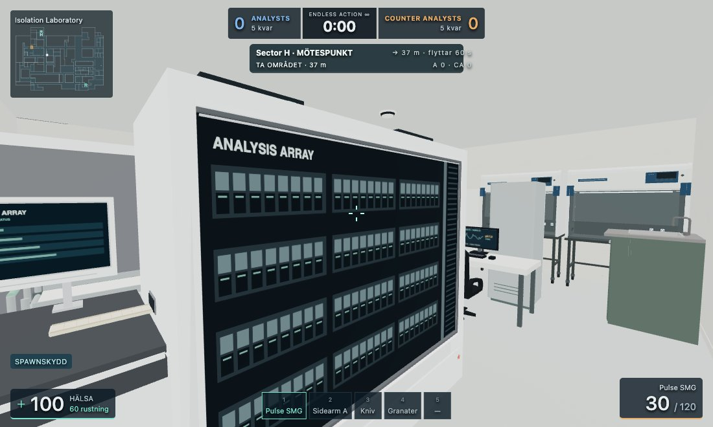
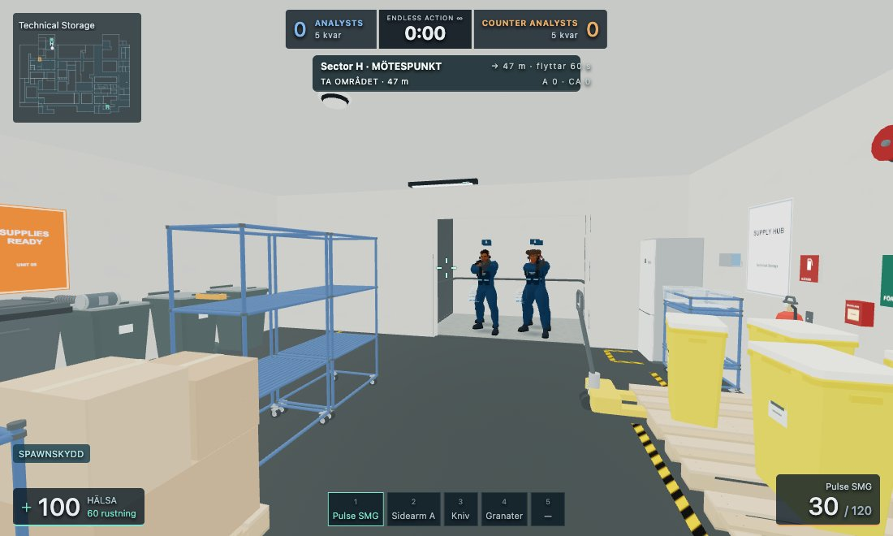
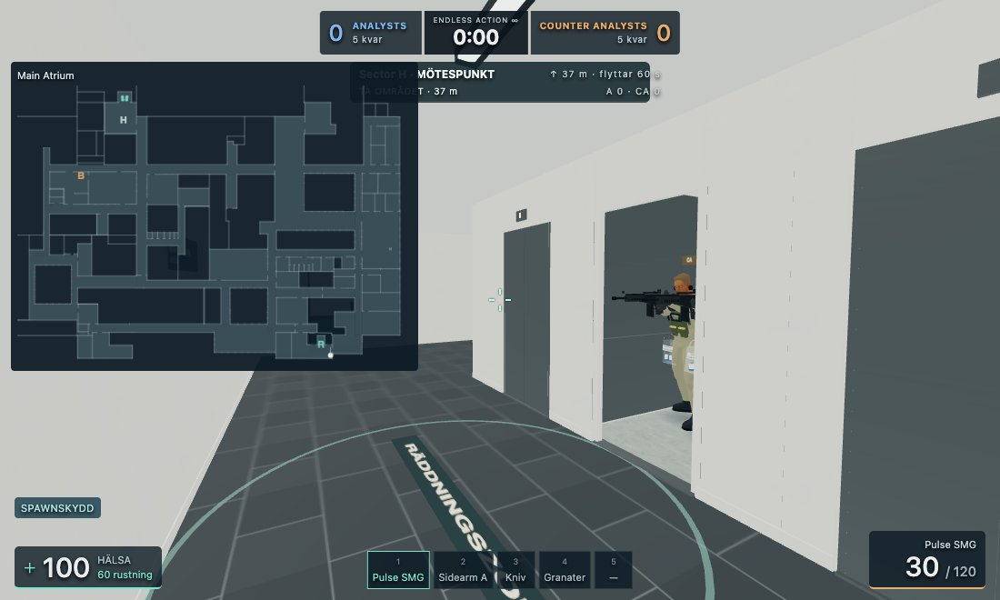
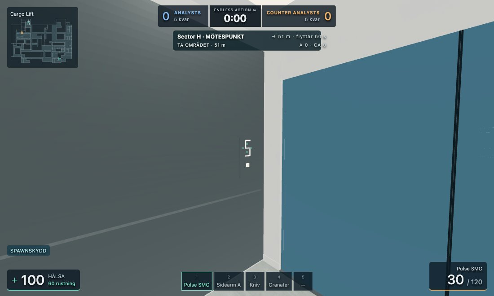
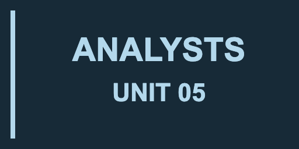

# Unit 05 – spelarsynlig fiktion

Anläggningen heter **Unit 05**. Korridorerna använder **Sector A–X**; övriga ytor har generiska namn som **North Laboratory**, **Analysis Chamber**, **Isolation Laboratory**, **Technical Storage**, **Operations Office** och **Main Atrium**. Hissarna heter **Cargo Lift** och **Transit Lift**. Samma tekniska rumsankare ger samma visningsnamn i HUD, områdesmeddelanden och skyltar.

**Cartridge-Strike**, **Analysts** och **Counter Analysts** behålls. Affischer, tavlor, skärmar, instrumentfronter, utrustningsmärken och karaktärsmärken använder egen generisk grafik och fiktiv text. Synliga vapenbenämningar är generiska, medan deras tekniska ID:n är oförändrade.

`src/fps/player-names.mjs` äger visningsnamnen. Ursprungliga namn som behövs för intern klassificering och källspårning används inte som speltext. Projektets skylt- och affischtexter samt dess äldre redigerbara kopia är synkroniserade. Källfiler, modell-/materialnamn, animationer, filvägar och licenskrediter behålls. Ingen lista över ursprungsnamn och ersättningsnamn publiceras här.

Importerad utrustning får nya material på presentationskopiorna via `src/fps/fictional-equipment.mjs`. Original-GLB:er, UV:er, geometribuffertar och cachade källmaterial ändras inte. Nya instrumentpaneler och skärmbilder är lokalt genererad grafik. Inlästa modeller, material och texturer återanvänds mellan instanser.

## Kontroll

- 290 relevanta regressionstester passerade, inklusive namnkonsekvens, originalresursernas livscykel och oförändrade geometribuffertar.
- Projektstruktur utan visningstext, kollisionsboxar och navigeringsnoder har samma SHA-256 som basversionen. Alla 1 020 projektföremål, gisslanpositioner, spelregler och banans geometri behålls.
- Faktisk Chromium/WebGL-kontroll av sju rum/vyer, HUD, utökad minikarta, båda hissarna öppna/stängda, karaktärsmärken och köpmenyn. Standard och låg grafik kontrollerade.
- Både standardbanan och Classic startade utan rapporterade sid-/konsolfel. 324 unika texter fångades där de faktiskt ritades på canvas; DOM och sidtitlar granskades också. Inga kvarvarande matchningar i det kontrollerade spelarsynliga textunderlaget.
- Materialkontrollen verifierade fem typer av ersättningsgrafik i den renderade scenen och att originalens material fortfarande var orörda. De granskade kamerorna behöll exakt samma triangelantal och draw calls som före textpasset.
- Publiceringsmanifestet är uppdaterat och verifierat: 633 runtimefiler, version 0.18.0.

[WebGL-resultat](player-facing-fiction/report.json). Kör `node tools/player-names-smoke.mjs` med en lokal HTTP-server. Kamerorna är arrangerade på gångbara ytor. Detta är ett avgränsat lokalt mjukvaru-WebGL-prov, inte ett manuellt matchtest eller en fysisk mobil-/Safari-verifiering. Framtida privat importerade bilder och modeller ingår inte i genomgången av repots nuvarande innehåll.

